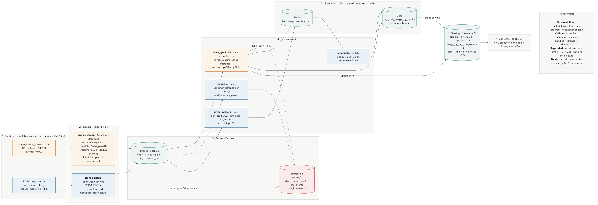

# Cloud Provider Analytics

Proyecto integrador · Big Data · ITBA · 2C 2026 · Prof. Diego Mosquera<br>
**Estado: Entrega 2 — Implementación técnica y MVP end-to-end mínimo (16/11/2026)**<br>
Autores:
- Francisco Gomes · Legajo 64450
- Iván Josephsohn · Legajo 63737
- Katia Menshikoff · Legajo 64396
- Julián Ariel Szarfmeser · Legajo 67032

Pipeline ETL + Streaming + Serving para analítica de FinOps, Soporte y Producto de un proveedor cloud:
Landing → Bronze → Silver → Gold (Parquet) → Cassandra/AstraDB, con PySpark 4 y Structured Streaming.



## Artefactos de la Entrega 2

| Artefacto (consigna, Sección 6.3) | Dónde |
|---|---|
| Documento de la entrega (implementación, evidencias, trade-offs, trazabilidad) | [`docs/05_documento_entrega2.md`](docs/05_documento_entrega2.md) (también en PDF: `docs/05_documento_entrega2.pdf`) |
| Código reproducible (Bronze/Silver/Gold en Parquet) | [`src/cpa/`](src/cpa) · orquestador `src/cpa/pipeline.py` |
| Scripts CQL | [`infra/cql/01_schema.cql`](infra/cql/01_schema.cql) · [`infra/cql/02_consultas.cql`](infra/cql/02_consultas.cql) |
| Diagrama actualizado (sólo lo implementado) | [`docs/diagramas/arquitectura_v2.png`](docs/diagramas/arquitectura_v2.png) · [`flujo_streaming_v2.png`](docs/diagramas/flujo_streaming_v2.png) · fuentes `.mmd` |
| Log de decisiones (patrón, particiones, claves Cassandra, umbrales) con trade-offs | [`DECISIONS.md`](DECISIONS.md) |
| Evidencias de ejecución (logs, rutas, tamaños, conteos, quarantine, consultas) | [`evidence/e2/`](evidence/README.md) |
| Plan de correcciones (feedback de la E1) | [`docs/03_plan_correcciones.md`](docs/03_plan_correcciones.md) |
| Backlog priorizado para el MVP final | [`docs/06_backlog_final.md`](docs/06_backlog_final.md) |
| Registro de cambios | [`docs/04_registro_cambios.md`](docs/04_registro_cambios.md) |

Los artefactos de la Entrega 1 (diseño v1.1, inventario de fuentes, perfil, MapReduce) se conservan sin cambios: [`docs/01_documento_diseno.md`](docs/01_documento_diseno.md).

## Quickstart (desde un entorno limpio)

Requisitos: Python 3.11+ · Java 17 o 21 · Docker (para Cassandra local). Probado con Python 3.13.9, OpenJDK 21, PySpark 4.0.1, cassandra-driver 3.30.1 y Cassandra 5.0 sobre macOS (colima).

```bash
# 0. Dependencias (~2-3 min)
python3 -m venv .venv && source .venv/bin/activate
pip install -r requirements.txt

# 1. Landing: descomprimir el dataset (inmutable) y verificar hashes
scripts/setup_landing.sh ruta/a/cloud_provider_challenge_dataset_v1.zip

# 2. Cassandra 5 local (esperar a que el estado sea "healthy", ~1 min)
docker compose -f infra/docker-compose.yml up -d      # o: docker-compose -f infra/docker-compose.yml up -d
docker ps --filter name=cpa-cassandra --format '{{.Status}}'

# 3. Pipeline completo: Bronze batch + streaming, Silver, Gold, reconciliación, anomalías y Cassandra (~45 s)
scripts/run_pipeline.sh

# 4. Consultas CQL (Q1 y Q2)
docker exec -i cpa-cassandra cqlsh < infra/cql/02_consultas.cql

# 5. Evidencias y pruebas
PYTHONPATH=src python -m cpa.evidence          # regenera evidence/e2/
pytest -q tests                                # 24 pruebas
```

**Etapas sueltas:** `scripts/run_pipeline.sh --stages bronze_batch,silver_masters` (etapas: `bronze_batch`, `silver_masters`, `bronze_stream`, `silver_gold`, `reconcile`, `anomalies`, `serving`, y `backfill` para reconstruir Silver/Gold de todas las fechas). `--no-serving` corre sólo el lake, sin Cassandra.

**Demos de la entrega:**
- `scripts/demo_idempotencia.sh`: reinicia todo y corre el pipeline 3 veces (normal, re-ejecución, backfill) → `evidence/e2/idempotencia/resumen.md`.
- `scripts/demo_late_data.sh`: stream con watermark de 1, 7, 30 y 62 días en lakes temporales → `evidence/e2/late_data/resumen.md`.

**AstraDB en lugar de Cassandra local:** copiar `config/.env.example` a `.env` con `ASTRA_DB_SECURE_BUNDLE_PATH`, `ASTRA_DB_TOKEN` (y opcionalmente `ASTRA_DB_KEYSPACE`), crear el keyspace `cpa` desde la consola de Astra y correr `scripts/run_pipeline.sh`. El código detecta las variables y usa AstraDB (D-11).

**Configuración:** `config/pipeline.example.yaml` (copiar a `config/pipeline.yaml` para cambiarla): rutas del lake, Spark, `maxFilesPerTrigger`, watermark, umbrales de calidad y de anomalías. Sin credenciales: los secretos van en `.env` (ignorado por git).

**Google Colab:** subir el repo y el zip a Drive, `!pip -q install -r requirements.txt`, ajustar `paths.lake_root` a Drive y correr `!scripts/run_pipeline.sh --no-serving` (en Colab no hay Docker; para el serving usar AstraDB).

**Limpieza / reinicio:** `scripts/reset.sh` borra Bronze, Silver, Gold, quarantine, checkpoints y metadatos (Landing queda intacta) y vacía las tablas de Cassandra. Bronze y los checkpoints se borran siempre juntos.

**Regenerar los PDF** (requiere pandoc, poppler y Google Chrome): `python scripts/build_pdf.py 05_documento_entrega2` (E2) o `python scripts/build_pdf.py` (E1).

### Solución de problemas

| Síntoma | Causa | Solución |
|---|---|---|
| `NoHostAvailable` al conectar a Cassandra | El contenedor todavía arranca | Esperar a `healthy` (`docker ps`) o correr con `--no-serving` |
| `docker: 'compose' is not a docker command` | Falta el plugin compose | Usar `docker-compose -f infra/docker-compose.yml up -d` |
| `Cannot connect to the Docker daemon` (macOS con colima) | colima apagado | `colima start` |
| Fechas corridas un día | Sesión Spark en hora local | La config fuerza UTC (D-07); no cambiar `session_timezone` |
| El stream no procesa nada | Los checkpoints ya confirmaron esos archivos (es el comportamiento idempotente esperado) | `scripts/reset.sh` para reprocesar desde cero |
| `JAVA_HOME` / `Java gateway process exited` | Java no instalado o versión no soportada | Instalar Java 17 o 21 |

## Estructura

```
README.md            objetivo, arquitectura, ejecución
DECISIONS.md         decisiones, alternativas y trade-offs (D-01 a D-15)
docs/                diseño v1, implementación v2, diagramas, plan de correcciones, backlog
data/                cómo obtener los datos (no se versionan)
src/cpa/             pipeline E2: pipeline (etapas), transforms (lógica compartida), schemas, serving, evidence
src/profiling/       perfil de Landing (E1)
src/mapreduce/       flujo batch de referencia MapReduce + PySpark (E1)
notebooks/           exploración con PySpark (Colab)
tests/               24 pruebas: MapReduce, transformaciones, integración del stream
config/              configuración externalizada, sin credenciales
infra/               docker-compose de Cassandra y scripts CQL
scripts/             setup de Landing, ejecución, reinicio, demos, PDF
evidence/            salidas que demuestran la ejecución (E1 y e2/)
```

## Resultados principales de la Entrega 2

- **43.200 eventos** ingeridos por streaming en 12 micro-batches con watermark de 62 días: 0 descartados. Con 1 día se descartarían 35.383 (81,9 %, medido con Spark); el balance Landing = Bronze + descartes cierra siempre y los tardíos van a `quarantine/late_events`.
- **Silver:** 42.989 eventos válidos + **211 en quarantine** (Q02, costo < −0,01), con `rule_id`, motivo y archivo de origen.
- **Gold `org_daily_usage_by_service`: 11.050 filas, idénticas al MapReduce de la E1** (0 claves de diferencia).
- **Cassandra:** Q1 (rango de fechas por org) y Q2 (top-N servicios en 14 días), cada una en una sola partición.
- **Anomalías:** 191 eventos (0,44 %) con z robusto > 3,5 que concentran el 7,5 % del costo.
- **Idempotencia:** 3 corridas con los mismos conteos y 0 claves duplicadas en 19 tablas (lake + Cassandra).

## Limitaciones de esta entrega
- La evidencia de serving es contra Cassandra 5 local; la corrida contra AstraDB real está en el backlog (B-01).
- De los 5 marts y 5 consultas del MVP final hay 2 implementados (los que pide la E2); el resto está priorizado en `docs/06_backlog_final.md`.
