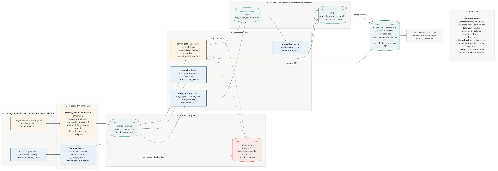
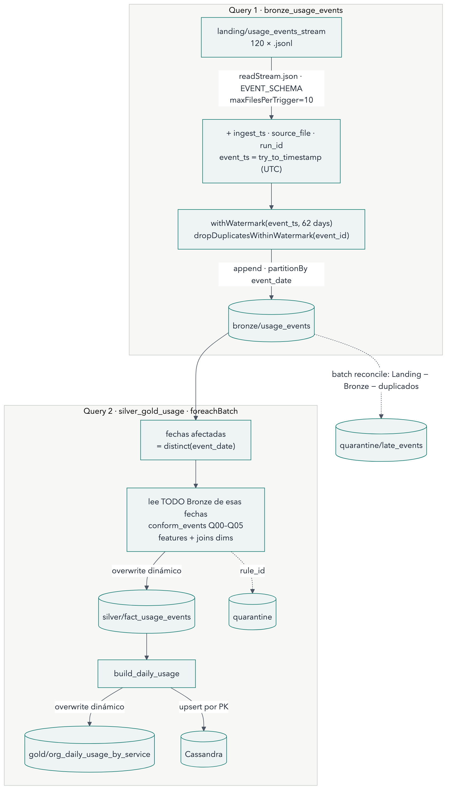

# Cloud Provider Analytics · Implementación técnica v2

**Segunda evaluación parcial · Implementación técnica y MVP end-to-end mínimo**<br>
Big Data · ITBA · 2C 2026 · Prof. Diego Mosquera<br>
Versión 2.0 · Fecha de entrega: 16/11/2026<br>

Autores:
- Francisco Gomes · Legajo 64450
- Iván Josephsohn · Legajo 63737
- Katia Menshikoff · Legajo 64396
- Julián Ariel Szarfmeser · Legajo 67032

> Este documento cubre los 12 componentes del alcance mínimo (consigna, Sección 6.2). Cada sección indica a qué componente responde.
> Todas las cifras salen de `evidence/e2/`, que genera `PYTHONPATH=src python -m cpa.evidence` a partir del lake y se puede volver a generar. El diseño de referencia sigue siendo el documento v1 (`docs/01_documento_diseno.md`); acá se documenta lo implementado y lo que cambió.

---

## 0. Resumen ejecutivo

| Tema | Resultado E2 |
|---|---|
| Pipeline | `scripts/run_pipeline.sh` ejecuta 7 etapas idempotentes: Landing → Bronze → Silver → Gold → Cassandra. Desde un lake vacío tarda **~42 s** en `local[*]`. |
| Batch | 7 fuentes CSV a Bronze Parquet con esquema explícito, `ingest_ts`, `source_file`, `run_id`, deduplicación y quarantine. |
| Streaming | 120 archivos JSONL → 12 micro-batches → Bronze con **watermark de 62 días**, `dropDuplicatesWithinWatermark(event_id)` y checkpoint. 43.200 eventos, 0 descartados. |
| Silver | Eventos conformados (v1/v2, `try_cast`, unit derivada, joins con `dim_org` y `dim_resource`) + 4 maestros: `dim_org` (SCD2), `dim_user`, `dim_resource`, `fact_billing`. |
| Calidad | 11 reglas activas; 211 eventos en quarantine (Q02) con muestras; balance Landing = Bronze + descartes verificado en cada corrida. |
| Gold | `org_daily_usage_by_service`: **11.050 filas, idénticas al MapReduce de la E1** (0 claves de diferencia). Más `cost_anomaly_mart`. |
| Serving | Keyspace `cpa` en Cassandra 5 (Docker; AstraDB por `.env`), 2 tablas *query-first*, 2 consultas con CQL y captura. |
| Analítica | z robusto MAD por servicio+métrica: 191 eventos anómalos (0,44 %) que concentran el 7,5 % del costo. |
| Idempotencia | 3 corridas (normal, re-ejecución, backfill completo): **mismos conteos y 0 claves duplicadas en 19 tablas**, incluida Cassandra. |
| Pruebas | 24 tests (`pytest`), uno de integración del stream con duplicados, JSON corrupto y un tardío. |
| Feedback E1 | Trade-offs explícitos en todas las decisiones (`DECISIONS.md` v2.0) y matriz de trazabilidad requisito → evidencia (Sección 13). |

---

## 1. Correcciones de la Entrega 1 y arquitectura actualizada (consigna 6.2 · Correcciones y arquitectura)

El plan de correcciones completo, con prioridad, responsable, fecha y evidencia, está en [`03_plan_correcciones.md`](03_plan_correcciones.md). Resumen:

| Feedback | Qué hicimos | Dónde |
|---|---|---|
| "Los trade-offs podrían explicitarse todavía un poco más frente a algunas alternativas" (Arquitectura, 9,5) | Cada decisión tiene una tabla alternativa → qué ganaríamos → qué perderíamos → **señal de reversión** | `DECISIONS.md` v2.0; Sección 12 |
| "Conservar esta trazabilidad mientras convierten el diseño en pipeline reproducible" | `run_id` y `source_file` en cada fila, `run_log` por etapa, balance Landing vs Bronze, Gold comparado contra el MapReduce de la E1 y matriz requisito → evidencia | Secciones 10 y 13 |
| Decisiones abiertas A1–A5 | Cerradas con evidencia de ejecución | Sección 12 |

### 1.1 Arquitectura v2 (lo implementado)



_Fuente editable: [`diagramas/arquitectura_v2.mmd`](diagramas/arquitectura_v2.mmd). Cada caja corresponde a una etapa de `src/cpa/pipeline.py`._

### 1.2 Diferencias con la arquitectura v1

| Componente | v1 (diseño) | v2 (implementado) | Motivo |
|---|---|---|---|
| Streaming | Una query con `foreachBatch` para Silver/Gold | **Dos queries** encadenadas, cada una con su checkpoint (D-13) | El file sink de Bronze es *exactly-once*; `foreachBatch` no |
| Late data | Batch diario de reconciliación por `source_file` | Etapa `reconcile` por `event_id` con balance que debe cerrar (si no, la corrida falla) | Un balance por clave detecta duplicados, tardíos y filas sin clave por separado |
| Serving | AstraDB | Cassandra 5 en Docker por defecto; AstraDB con el mismo código vía `.env` (D-11) | Riesgo K4: demo reproducible sin red ni credenciales |
| Carga a Cassandra | A decidir (A5) | `cassandra-driver` con `INSERT` preparados concurrentes (D-12) | Funciona con Spark 4 sin JARs |
| Marts | 5 marts | `org_daily_usage_by_service` y `cost_anomaly_mart`; los otros 3 en el backlog | Alcance de la E2 (consigna 6.2) |
| Parseo de tiempos | `to_timestamp` | `try_to_timestamp` (D-15) | Con ANSI (Spark 4) un dato malo cortaba el stream |

---

## 2. Batch a Bronze (consigna 6.2 · Batch a Bronze)

Etapa `bronze_batch` (`src/cpa/pipeline.py`). Se ingieren las **7 fuentes CSV** (la consigna pide al menos 3 maestros).

| Paso | Implementación |
|---|---|
| Tipificación explícita | `StructType` por fuente en `src/cpa/schemas.py` (D-04); `mode=PERMISSIVE` + `_corrupt_record`; `escape='"'` |
| Columnas técnicas | `ingest_ts`, `source_file` (`_metadata.file_path`), `run_id`, `record_hash` (SHA-256 de las columnas de negocio) |
| Deduplicación | Por clave natural (`org_id`, `user_id`, `invoice_id`, …); la primera aparición queda en Bronze y las copias van a quarantine (B02) |
| Quarantine | `quarantine/bronze_<fuente>` con `rule_id`: B00 no parsea, B01 clave nula, B02 clave duplicada |
| Particiones | `ingest_date` (snapshot del día) y `month` para facturación; overwrite dinámico → re-ejecutar el mismo día reemplaza el snapshot |

| Tabla Bronze | Filas | Partición | Archivos | Claves duplicadas |
|---|---|---|---|---|
| `customers_orgs` | 80 | `ingest_date` | 1 | 0 |
| `users` | 800 | `ingest_date` | 1 | 0 |
| `resources` | 400 | `ingest_date` | 1 | 0 |
| `billing_monthly` | 240 | `month` (3) | 3 | 0 |
| `support_tickets` | 1.000 | `ingest_date` | 1 | 0 |
| `marketing_touches` | 1.500 | `ingest_date` | 1 | 0 |
| `nps_surveys` | 92 | `ingest_date` | 1 | 0 |

_Evidencia: `evidence/e2/lake_inventory.md` (rutas y tamaños) y `evidence/e2/esquemas/bronze.*.txt` (`printSchema`)._

**Error detectado y corregido:** en la primera corrida, 211 de los 400 recursos fueron a quarantine como B00. El CSV escapa las comillas del JSON embebido duplicándolas (`"[""env:prod""]"`) y Spark espera `\` por defecto. Con `escape='"'` entran los 400. Es el tipo de error que la quarantine debe hacer visible en lugar de perder datos en silencio.

---

## 3. Streaming a Bronze (consigna 6.2 · Streaming a Bronze)



_Fuente editable: [`diagramas/flujo_streaming_v2.mmd`](diagramas/flujo_streaming_v2.mmd)._

| Requisito | Implementación (etapa `bronze_stream`) |
|---|---|
| Esquema explícito | `readStream.schema(EVENT_SCHEMA).json(...)`: unificado v1/v2, `value` como string |
| Micro-lotes | `maxFilesPerTrigger=10` → 12 micro-batches de 3.600 eventos; `trigger(availableNow=True)` para que la demo sea determinística |
| Watermark | `withWatermark("event_ts", "62 days")` (D-05) |
| Deduplicación | `dropDuplicatesWithinWatermark(["event_id"])` |
| Checkpoint | `_checkpoints/bronze_usage_events`; file sink en modo append (*exactly-once*) |
| Late data | Los descartados por el watermark se recuperan en la etapa `reconcile` → `quarantine/late_events` |

**Progreso por micro-batch** (`evidence/e2/streaming_bronze_progress.json`, extraído del *query progress* de Spark):

| Batch | Filas de entrada | Watermark después del batch | Estado (claves) | Descartados por watermark | Duración |
|---|---|---|---|---|---|
| 0 | 3.600 | 1970-01-01 (sin watermark aún) | 3.600 | 0 | 1,5 s |
| 1 | 3.600 | 2025-06-30 23:42 | 7.200 | 0 | 1,0 s |
| … | … | … | … | … | … |
| 11 | 3.600 | 2025-06-30 23:58 | 43.200 | 0 | 0,8 s |

El máximo `event_time` ya es 31/08 desde el primer archivo, así que el watermark queda fijo en 30/06 (31/08 − 62 días): ningún evento del rango 03/07–31/08 queda detrás. El estado del dedup termina en 43.200 claves.

### 3.1 Late data medido con Spark real

En la E1 el desorden temporal se simuló en Python. En la E2 se midió con el stream real, en lakes temporales (`scripts/demo_late_data.sh`):

| Watermark | Llegan a Bronze | Descartados → `quarantine/late_events` | % descartado | Balance |
|---|---|---|---|---|
| 1 día | 7.817 | 35.383 | 81,9 % | cierra |
| 7 días | 11.433 | 31.767 | 73,5 % | cierra |
| 30 días | 25.294 | 17.906 | 41,4 % | cierra |
| **62 días (elegido)** | **43.200** | **0** | **0 %** | cierra |

_Evidencia: `evidence/e2/late_data/` (resumen, balance y query progress de cada caso)._

Dos verificaciones: (1) el conteo de la reconciliación coincide exactamente con el contador interno `numRowsDroppedByWatermark` de Spark en los 4 casos; (2) el balance `Landing = Bronze + duplicados + tardíos + sin_clave` cierra siempre, o sea que **ningún evento se pierde en silencio** (objetivo O4). Los porcentajes son menores que los de la simulación de la E1 (97,5 % con 1 día) porque allá se simulaba 1 archivo por trigger y acá son 10: el primer micro-batch entra completo antes de que exista watermark.

---

## 4. Silver (consigna 6.2 · Silver)

### 4.1 Eventos: `silver/fact_usage_events`

La etapa `silver_gold` lee Bronze como stream (query 2, checkpoint `_checkpoints/silver_gold_usage`). En cada `foreachBatch` toma las **fechas afectadas**, lee todos los eventos de Bronze de esas fechas y reconstruye las particiones completas con overwrite dinámico (diseño, Sección 8.3). Así un evento tardío corrige el día que corresponde y re-ejecutar da el mismo resultado.

| Transformación | Detalle | Resultado |
|---|---|---|
| Normalización | `lower(trim())` de `service`, `region`, `metric` | — |
| Q04 tipos ambiguos | `value_raw` se conserva; `value = try_cast(value_raw AS double)` | Los 1.309 `value` texto eran numéricos: castean todos (0 no casteables) |
| Q03 unit nula | Se deriva de `metric` (`requests→count`, `cpu_hours→hours`, `storage_gb_hours→gb_hours`) + `flag_unit_derived` | 2.069 derivadas (las otras 6 de las 2.075 del perfil están en quarantine) |
| Evolución de esquema | v1 sin `carbon_kg`/`genai_tokens` (quedan nulos, no 0); `schema_version` conservado | v1: 10.738 · v2: 32.251 eventos |
| Joins de enriquecimiento | `broadcast` de `dim_org` vigente (nombre, industria, plan, región) y `dim_resource` (estado, PII) | 100 % de match |
| Features por evento | `cost_usd`, `requests`, `cpu_hours`, `storage_gb_hours` (pivot de `metric`/`value`), `genai_tokens`, `carbon_kg` | 6 features (la consigna pide 3) |

_Evidencia: `evidence/e2/muestras/silver_correcciones_Q03_Q04.csv`, `silver_flags.json` y `esquemas/silver.fact_usage_events.txt`._

### 4.2 Maestros (etapa `silver_masters`)

| Tabla | Tratamiento | Resultado |
|---|---|---|
| `dim_org` | **SCD tipo 2** por `record_hash`: si cambia algún atributo se cierra la versión vigente (`valid_to`, `is_current=false`) y se abre otra; normaliza `plan_tier`/`hq_region`; NPS fuera de [-100,100] a nulo con flag; flag de plan incoherente | 80 versiones vigentes; re-aplicar el mismo snapshot no crea versiones (test) |
| `dim_user` | `email` → `email_hash` SHA-256 (D-10); Q07 `last_login < created_at` → flag | 800 usuarios, 232 con flag |
| `dim_resource` | `tags_json` → `array<string>`; `resource_has_pii` | 400 recursos, 85 con PII |
| `fact_billing` | Q10 `credits` nulo → 0; Q09 nota de crédito; Q08 FX USD sospechoso; montos en USD (D-06) | 240 facturas: Q08 = 144, Q09 = 13, Q10 = 137 |

---

## 5. Calidad y quarantine (consigna 6.2 · Calidad)

Reglas activas (las de la consigna marcadas con ★):

| ID | Regla | Tipo | Dónde | Registros afectados |
|---|---|---|---|---|
| B00–B02 | CSV no parseable / clave nula / clave duplicada | Bloqueante → `quarantine/bronze_*` | Bronze batch | 0 (tras corregir el `escape`) |
| ★ Q01 | `event_id` no nulo y único | Bloqueante → quarantine | Bronze stream (dedup) + Silver | 0 nulos, 0 duplicados |
| Q00 | `event_ts` parseable | Bloqueante → quarantine | Silver / reconcile | 0 |
| ★ Q02 | `cost_usd_increment >= -0.01`; si no, quarantine con `flag_cost_anomaly` | Bloqueante | Silver | **211** |
| ★ Q03 | `unit` no nula cuando hay `value` (se deriva de `metric`) | Corrección + flag | Silver | 2.069 |
| Q04 | `value` casteable a double | Corrección + flag | Silver | 0 no casteables |
| Q05 | `org_id` y `resource_id` existen en las dimensiones | Bloqueante | Silver | 0 |
| Q07 | `last_login >= created_at` | Advertencia (flag) | `dim_user` | 232 |
| Q08 | FX de USD en [0,99; 1,01] | Advertencia (flag) | `fact_billing` | 144 |
| Q09 | `subtotal < 0` = nota de crédito | Advertencia (flag) | `fact_billing` | 13 |
| Q10 | `credits` nulo → 0 | Corrección + flag | `fact_billing` | 137 |
| L01 | Evento descartado por el watermark | → `quarantine/late_events` | reconcile | 0 con 62 días (35.383 con 1 día) |

Cada fila en quarantine lleva `rule_id`, `reason`, `quarantine_ts`, el `run_id` y su `source_file`, así que se puede volver al archivo y a la línea de origen. Muestra (`evidence/e2/quarantine/silver_usage_events_muestra.csv`):

| rule_id | event_id | org_id | service | cost_usd_increment | source_file |
|---|---|---|---|---|---|
| Q02 | evt_05rs1cd7uxv6 | org_1n13jcat | compute | −7,7014 | events_part_0009.jsonl |
| Q02 | evt_07y0qnbewq73 | org_kdgigatj | database | −0,506 | events_part_0063.jsonl |
| Q02 | evt_0buvvhr9d2og | org_5935a0l7 | compute | −10,99 | events_part_0037.jsonl |

**Balance de la corrida** (`evidence/e2/reconciliation.json` y conteos del `run_log`): 43.200 en Landing = 43.200 en Bronze; 43.200 en Bronze = 42.989 en Silver + 211 en quarantine. **Ningún registro se pierde sin motivo (O4).**

---

## 6. Gold (consigna 6.2 · Gold)

`gold/org_daily_usage_by_service` · grano **org_id × usage_date × service** · partición `usage_date` · 11.050 filas en 60 archivos.

| Columna | Definición |
|---|---|
| `daily_cost_usd` | Σ `cost_usd_increment` de los eventos válidos (incluye ajustes de redondeo ≥ −0,01) |
| `requests`, `cpu_hours`, `storage_gb_hours` | Σ `value` según `metric` (`value` nulo cuenta 0) |
| `genai_tokens`, `carbon_kg` | Σ de los campos v2 (v1 aporta 0) |
| `events`, `events_value_unparseable` | Cantidad de eventos y cuántos tenían `value` no casteable |
| `max_schema_version`, `org_name`, `plan_tier` | Contexto para el consumo |
| `gold_run_id` | Linaje: corrida que escribió la fila |

**Validación cruzada con la E1** (`evidence/e2/gold_vs_mapreduce.json`): Gold y la salida del MapReduce de referencia tienen las mismas **11.050 claves** (0 sólo en uno de los dos) y las mismas métricas (diferencia máxima 5·10⁻⁵ en `carbon_kg`, por redondeo). La implementación reproduce exactamente el diseño validado en la E1.

---

## 7. Serving en Cassandra (consigna 6.2 · Serving)

Keyspace `cpa` y tablas en [`infra/cql/01_schema.cql`](../infra/cql/01_schema.cql); consultas en [`infra/cql/02_consultas.cql`](../infra/cql/02_consultas.cql).

| Consulta | Tabla | PRIMARY KEY | Por qué |
|---|---|---|---|
| Q1 · Costos y requests diarios por org y servicio en un rango de fechas | `usage_by_org_day_service` | `((org_id), usage_date, service)`, `usage_date DESC` | Igualdad por org = 1 partición (~140 filas); el rango de fechas es un *slice* del clustering |
| Q2 · Top-N servicios por costo de los últimos 14 días | `cost_14d_by_org_service` | `((org_id, as_of_date), cost_14d_usd, service)`, `cost DESC` | El top-N es un `LIMIT` sobre filas ya ordenadas; la partición se borra y reescribe en cada corrida (las columnas de la clave no se actualizan) |

**Carga:** desde Spark con `cassandra-driver` (D-12): Q1 se actualiza en cada `foreachBatch` (frescura) y se recarga completa en la etapa `serving`; Q2 se calcula sobre Gold con `as_of_date` = última fecha con datos (31/08/2025) y ventana 18/08–31/08.

**Resultados** (`evidence/e2/serving/cqlsh_consultas.txt`, salida de `cqlsh`):

```text
-- Q1: org_pbhsahxt, 05/08 a 07/08 (14 filas; se muestran 5)
 usage_date | service    | daily_cost_usd | requests | cpu_hours | storage_gb_hours | genai_tokens | events
 2025-08-07 |    compute |        13.3837 |      135 |    1.9695 |           16.151 |            0 |      3
 2025-08-07 |      genai |        67.1041 |      468 |    2.9424 |          70.6875 |         7995 |      9
 2025-08-07 | networking |         1.4729 |      131 |         0 |          17.6962 |            0 |      3
 2025-08-06 |  analytics |         8.1546 |      112 |    1.3106 |           3.2471 |            0 |      3
 2025-08-06 |    compute |        20.0276 |      215 |    1.3315 |          47.5064 |            0 |      6

-- Q2: top-5 de org_pbhsahxt al 31/08/2025
 service    | cost_14d_usd | requests_14d | window_start | as_of_date
      genai |     545.5562 |         4212 |   2025-08-18 | 2025-08-31
    compute |      246.016 |         2986 |   2025-08-18 | 2025-08-31
   database |       80.007 |         1457 |   2025-08-18 | 2025-08-31
  analytics |      55.6149 |          712 |   2025-08-18 | 2025-08-31
 networking |      33.5261 |         3143 |   2025-08-18 | 2025-08-31
```

Filas en Cassandra: `usage_by_org_day_service` = 11.050 (= Gold) y `cost_14d_by_org_service` = 262.

---

## 8. Analítica: detección de anomalías de costo (consigna 6.2 · Analítica o ML)

| Aspecto | Detalle |
|---|---|
| Método | z robusto `0,6745·(x − mediana)/MAD` por servicio+métrica sobre Silver; anomalía si \|z\| > 3,5 (D-08) |
| Salida | `gold/cost_anomaly_mart` · grano org × date × service: costo diario, eventos anómalos, costo anómalo, máximo \|z\|, `is_anomaly`, método |
| Métricas | 191 eventos anómalos de 42.989 (0,44 %); 190 filas org×día×servicio de 69 orgs; **7,5 % del costo total** está en eventos anómalos |
| Por servicio (filas anómalas) | compute 64 · storage 35 · database 30 · networking 26 · analytics 20 · genai 15 |
| Caso extremo | `org_x7eedtjv` · compute · 09/07: 1 evento de 302,35 USD (z = 168,5) en un día de 311,26 USD |
| Trazabilidad con E1 | 312 outliers en el perfil crudo = 123 costos < −0,01 (los atrapa Q02 antes) + 189 picos; recalculado sobre Silver: 191 |
| Limitaciones | Univariado; sin etiquetas no se puede medir precisión ni *recall*; el umbral 3,5 es el estándar de Iglewicz y Hoaglin, no está calibrado con el negocio |
| Plan de cierre | Tabla Cassandra para el mart (B-05); IsolationForest como comparación (deseable D-03) |

_Evidencia: `evidence/e2/analitica/metricas.json` y `top_anomalias.csv`._

---

## 9. Idempotencia (consigna 6.2 · Idempotencia)

`scripts/demo_idempotencia.sh` reinicia el lake y Cassandra y ejecuta el pipeline **tres veces**:
1. **Corrida 1:** completa desde un lake vacío.
2. **Corrida 2:** igual, sin tocar nada. Los checkpoints hacen que el stream no relea archivos (`bronze_stream in=0`, `silver_gold micro-batches=0`); el batch reescribe los snapshots del día con overwrite dinámico.
3. **Corrida 3:** `--stages backfill,anomalies,serving`: reprocesa Silver, Gold y Cassandra para **todas** las fechas.

| Tabla | Corrida 1 | Corrida 2 | Corrida 3 | Claves duplicadas |
|---|---|---|---|---|
| bronze.usage_events | 43.200 | 43.200 | 43.200 | 0 / 0 / 0 |
| silver.fact_usage_events | 42.989 | 42.989 | 42.989 | 0 / 0 / 0 |
| silver.dim_org (SCD2) | 80 | 80 | 80 | 0 / 0 / 0 |
| gold.org_daily_usage_by_service | 11.050 | 11.050 | 11.050 | 0 / 0 / 0 |
| quarantine.silver_usage_events | 211 | 211 | 211 | — |
| cassandra.usage_by_org_day_service | 11.050 | 11.050 | 11.050 | PK (upsert) |
| cassandra.cost_14d_by_org_service | 262 | 262 | 262 | PK (borrar + insertar) |

Tabla completa (19 tablas, todas iguales): `evidence/e2/idempotencia/resumen.md`.

| Mecanismo | Dónde |
|---|---|
| Checkpoint + file sink *exactly-once* | Bronze de eventos |
| `dropDuplicatesWithinWatermark(event_id)` + Q01 en Silver | Eventos duplicados entre archivos |
| Overwrite dinámico de particiones reconstruidas completas | Bronze batch, Silver, Gold |
| SCD2 por hash: el mismo snapshot no crea versiones | `dim_org` |
| `INSERT` por PK completa (upsert); borrar + insertar por partición | Cassandra |
| `scripts/reset.sh` borra Bronze **y** checkpoints juntos | Si se borrara sólo el checkpoint, el stream re-agregaría los 120 archivos (append) |

---

## 10. Gobierno preliminar (consigna 6.2 · Gobierno preliminar)

### 10.1 Responsabilidades (owners)

| Dominio / capa | Owner | Tablas |
|---|---|---|
| Arquitectura, metadatos, linaje | Katia Menshikoff | `_metadata/*`, `DECISIONS.md` |
| FinOps-revenue y Soporte (batch + calidad) | Julián A. Szarfmeser | Bronze batch, `dim_*`, `fact_billing` |
| FinOps-uso y Producto (streaming) | Iván Josephsohn | `bronze/usage_events`, `fact_usage_events`, `org_daily_usage_by_service` |
| FinOps-anomalías y serving | Francisco Gomes | `cost_anomaly_mart`, keyspace `cpa` |

### 10.2 Controles, metadatos y linaje

| Control | Implementación | Evidencia |
|---|---|---|
| Landing inmutable | `scripts/setup_landing.sh` deja Landing en sólo lectura y verifica hashes | `evidence/profile/landing_manifest.sha256` |
| Linaje a nivel fila | Bronze: `run_id`, `source_file`, `ingest_ts`, `record_hash`; Silver: `silver_run_id`; Gold: `gold_run_id`; Cassandra: `run_id` | `evidence/e2/esquemas/` |
| Linaje a nivel corrida | `_metadata/run_log` (Parquet): `run_id`, etapa, tabla, `rows_in/out/quarantine`, estado, duración, error, **git SHA** y archivo de configuración | `evidence/e2/run_log.csv` |
| Observabilidad del stream | *Query progress* de cada micro-batch (filas, watermark, estado, descartados, duración) | `_metadata/streaming_progress/` |
| Balance de completitud | `reconcile`: si `Landing ≠ Bronze + descartes` la corrida falla | `evidence/e2/reconciliation.json` |
| Manejo de errores | Cada etapa registra `FAILED` con el mensaje en el `run_log` y corta la corrida | `RunLog.stage` en `src/cpa/common.py` |

### 10.3 Acceso y seguridad

| Capa | Quién accede | Control |
|---|---|---|
| Landing / Bronze | Sólo ingeniería de datos | Contienen PII (`email`); Landing en sólo lectura |
| Silver | Ingeniería + analistas | `email` reemplazado por `email_hash` (D-10) |
| Gold / Cassandra | Consumidores de negocio | Sin PII; sólo agregados |
| Secretos | Nadie en el repo | `.env` (en `.gitignore`), `config/.env.example` sin valores reales; `secure-connect-*.zip` ignorado |

En producción, el acceso por capa se implementaría con permisos del *object storage* por prefijo y roles de Cassandra (`GRANT SELECT ON KEYSPACE cpa TO analyst`); para el MVP queda documentado (backlog, fuera de alcance).

---

## 11. Pruebas y reproducibilidad (consigna 6.2 · Pruebas y reproducibilidad)

| Aspecto | Implementación |
|---|---|
| Puesta en marcha | README · Quickstart: venv, `setup_landing.sh`, `docker-compose up`, `run_pipeline.sh`, `pytest` |
| Configuración externalizada | `config/pipeline.example.yaml` (rutas, Spark, watermark, umbrales, serving); `.env` para credenciales; flags `--stages`, `--no-serving`, `--watermark`, `--lake-root` |
| Logs | `run_log` en Parquet + salida `[run_log]` por consola + *query progress* del stream |
| Limpieza / reinicio | `scripts/reset.sh` (zonas derivadas + checkpoints + tablas Cassandra; Landing intacta) |
| Pruebas | **24 tests** (`evidence/tests_output.txt`): 6 del MapReduce de la E1; 17 unitarios de transformaciones (Q00–Q05, Q03/Q04, v1/v2, Gold, MAD con MAD = 0, SCD2 idempotente, FX, PII, ventana de 14 días); 1 de integración del stream sobre un Landing armado en el test (duplicado dentro y entre archivos, JSON corrupto, `event_id` nulo, costo inválido, tardío) que verifica balance, quarantine y re-ejecución |
| Bug encontrado por los tests | `to_timestamp` con ANSI (Spark 4) lanzaba excepción ante un timestamp mal formado y cortaba el stream → `try_to_timestamp` (D-15) |
| Tiempo desde lake vacío | ~42 s el pipeline completo (O7: ≤ 15 min incluyendo instalación) |

---

## 12. Trade-offs explícitos (respuesta al feedback de Arquitectura)

El detalle por decisión está en `DECISIONS.md` (tablas alternativa → ganaríamos → perderíamos → señal de reversión). Las cinco decisiones con más impacto:

| Decisión | Elegimos | En lugar de | Pagamos | A cambio de | Cambiaríamos si… |
|---|---|---|---|---|---|
| Patrón (D-01) | Lambda con lógica compartida | Kappa | Dos rutas de ingesta | No convertir 7 CSV estáticos en streams; batch simple | Los maestros llegaran como CDC continuo |
| Watermark (D-05) | 62 días + reconciliación | 1–30 días | Estado de dedup de 43.200 claves que crece con el volumen | 0 % de pérdida (medido: 41–82 % con delays cortos) | El estado superara ~1 GB → `MERGE` en Delta |
| Formato (D-02) | Parquet puro | Delta Lake / Iceberg | Sin ACID: idempotencia por overwrite de particiones completas | Cero dependencias; mismo código en local y Colab | Particiones demasiado grandes para reescribir enteras |
| Streaming (D-13) | Dos queries encadenadas | Una con todo en `foreachBatch` | ~6 s más por micro-batch | Bronze *exactly-once*; Silver reprocesable sin re-ingerir | O1 (≤ 5 min) en riesgo |
| Serving (D-11, D-12) | Cassandra en Docker + driver Python | AstraDB + Spark Cassandra Connector | Datos pasan por el driver; hace falta Docker | Demo sin red ni credenciales; sin JARs atados a Spark 4 | Gold > ~1 M filas por corrida o la cátedra exige AstraDB (sólo cambia `.env`) |

### Decisiones abiertas de la E1, cerradas

| ID | Pregunta | Decisión | Evidencia |
|---|---|---|---|
| A1 | FX de USD ≠ 1 | Aplicar tal cual + flag Q08 (D-06) | 144 facturas marcadas en `fact_billing` |
| A2 | Watermark | 62 días + reconciliación (D-05) | `evidence/e2/late_data/` |
| A3 | Formato | Parquet puro; Delta como deseable (D-02) | Backlog D-01 |
| A4 | Analítica | MAD por servicio+métrica (D-08) | `evidence/e2/analitica/` |
| A5 | Carga a Cassandra | Driver Python (D-12) | `evidence/e2/serving/` |

---

## 13. Trazabilidad: requisito → componente → evidencia

Continúa la matriz de la Sección 6 del diseño v1, ahora con la evidencia real de ejecución.

| ID | Requisito | Componente (código) | Evidencia E2 | Estado |
|---|---|---|---|---|
| R01 | Landing inmutable | `scripts/setup_landing.sh` | `landing_manifest.sha256` (hashes verificados) | ✅ |
| R02 | Batch CSV → Bronze, esquema explícito, columnas técnicas | `pipeline.bronze_batch`, `schemas.py` | `lake_inventory.md`, `esquemas/bronze.*` | ✅ |
| R03 | Streaming con esquema, watermark, dedup, late data, checkpoint | `pipeline.bronze_stream`, `pipeline.reconcile` | `streaming_bronze_progress.json`, `late_data/`, `reconciliation.json` | ✅ |
| R04 | Evolución de esquema v1/v2 | `transforms.conform_events` | `muestras/silver_flags.json` (v1 10.738 / v2 32.251) | ✅ |
| R05 | Tipos ambiguos con fallback | `try_cast`, `value_raw` | `muestras/silver_correcciones_Q03_Q04.csv` | ✅ |
| R06 | Reglas de calidad + quarantine | `transforms.split_by_rules` | `quarantine/resumen.json` + muestras | ✅ |
| R07 | Normalización y joins con dimensiones | `transforms.enrich_events`, `silver_masters` | `esquemas/silver.*` | ✅ |
| R08 | Features | `transforms.event_features`, `build_daily_usage` | `muestras/gold_top20_costo.csv` | ✅ |
| R09 | Anomalías | `transforms.build_cost_anomaly_mart` | `analitica/metricas.json` | ✅ |
| R10 | Marts FinOps, Soporte, Producto | `build_daily_usage` (+ anomalías) | `gold_vs_mapreduce.json` | 🟡 2 de 5 (resto: B-02 a B-04) |
| R11 | Serving query-first | `serving.py`, `infra/cql/` | `serving/cqlsh_consultas.txt` | 🟡 2 de 5 consultas |
| R12 | Idempotencia | checkpoints, overwrite dinámico, upserts | `idempotencia/resumen.md` | ✅ |
| R13 | Performance: particiones, archivos, tamaños | `write_partitioned` | `lake_inventory.md` | ✅ |
| R14 | Gobierno: metadatos, linaje, owners, seguridad | `common.RunLog`, Sección 10 | `run_log.csv` | ✅ preliminar |
| R15 | Objetivos O1–O7 | — | Tabla siguiente | ver abajo |

| Objetivo | Meta | Medido en la E2 | Estado |
|---|---|---|---|
| O1 Frescura del uso | ≤ 5 min | Micro-batch a Bronze ~1 s; Silver + Gold + upsert ~4–5 s por micro-batch (`run_log`) | ✅ en demo (`availableNow`); medir con trigger continuo (backlog D-06) |
| O2 Frescura batch | Antes de las 06:00 (D+1) | Batch completo en ~10 s | ✅ (sin scheduler) |
| O3 Unicidad | 0 `event_id` duplicados tras re-ejecutar | 0 en Silver y Gold en las 3 corridas | ✅ |
| O4 Calidad trazable | 100 % en Silver o quarantine | 43.200 = 42.989 + 211; balance de reconcile cierra | ✅ |
| O5 Trazabilidad | 100 % de Bronze con `ingest_ts`, `source_file`, `run_id` | 0 nulos en las 43.200 filas de `bronze/usage_events` (verificado) y en el test de integración | ✅ |
| O6 Serving en 1 partición | 5 consultas | Q1 y Q2 leen una sola partición | 🟡 2 de 5 |
| O7 Reproducibilidad | ≤ 15 min desde entorno limpio | Pipeline ~42 s; instalación de dependencias ~2–3 min | ✅ (validar en otra máquina: B-09) |

---

## 14. Limitaciones conocidas

- **Cassandra local, no AstraDB:** el código soporta AstraDB por `.env`, pero la evidencia de la E2 es contra Cassandra 5 en Docker (B-01).
- **Colab:** el pipeline corre en Colab (sólo PySpark), pero Docker no; en Colab el serving requiere AstraDB.
- **Recomputo por fecha:** con este desorden cada micro-batch toca las 60 fechas y reconstruye todo Silver/Gold. Es barato con 43 k eventos; a escala, el costo crece con el rango de fechas afectadas (acotado por el watermark).
- **SCD2 con un solo snapshot:** la fuente trae un único snapshot de orgs; la lógica de cambios está probada con datos sintéticos (test), no con datos reales.
- **O1 medido en `availableNow`:** la frescura real con trigger de 1 minuto queda para el backlog.

## 15. Problemas detectados al implementar y cómo se resolvieron

| # | Problema | Cómo apareció | Resolución | Decisión |
|---|---|---|---|---|
| 1 | 211 recursos a quarantine como corruptos | Quarantine de Bronze en la primera corrida | `escape='"'` en la lectura de CSV | D-04 |
| 2 | Un timestamp mal formado cortaba el job (ANSI en Spark 4) | Test de Q00 | `try_to_timestamp` | D-15 |
| 3 | 312 outliers en el perfil E1 vs 191 en Gold | Comparación con la E1 | 123 eran costos < −0,01 que Q02 manda a quarantine antes | D-08 |
| 4 | 720 archivos de ~10 KB en Bronze | Inventario del lake | Silver compacta a 1 archivo por fecha | D-14 |
| 5 | La re-ejecución pisaba el *query progress* de la corrida con datos | Recolector de evidencias | Un archivo de progreso por `run_id` | — |
| 6 | Borrar sólo el checkpoint duplicaría Bronze | Análisis del reinicio | `reset.sh` borra Bronze y checkpoints juntos; Silver deduplica igual (Q01) | D-13 |
| 7 | El plugin `docker compose` no estaba instalado | Puesta en marcha | El README documenta `docker compose` y `docker-compose` | D-11 |

## Próximos pasos (hacia el MVP final)

Backlog priorizado en [`06_backlog_final.md`](06_backlog_final.md): AstraDB real, los 3 marts y 3 consultas restantes, notebook de Colab, diccionario completo, presentación, video y defensa.
